<!-- © 2026 Debarshi Sau. All rights reserved. Design, artwork and code may not be copied, modified or redistributed. See LICENSE. -->

<a href="https://debarshisau.in"><picture><source media="(prefers-color-scheme: dark)" srcset="https://debarshi-profile.vercel.app/api/hero?theme=dark"></picture></a>

<picture><source media="(prefers-color-scheme: dark)" srcset="assets/marquee-dark.svg"></picture>

<a href="https://debarshisau.in"><picture><source media="(prefers-color-scheme: dark)" srcset="assets/link-portfolio-dark.svg"></picture></a>
<a href="https://rynce.in"><picture><source media="(prefers-color-scheme: dark)" srcset="assets/link-rynce-dark.svg"></picture></a>
<a href="https://www.instagram.com/i.am.rockdeba"><picture><source media="(prefers-color-scheme: dark)" srcset="assets/link-instagram-dark.svg"></picture></a>
<a href="https://www.facebook.com/debarshi.sau.12"><picture><source media="(prefers-color-scheme: dark)" srcset="assets/link-facebook-dark.svg"></picture></a>

 

<picture><source media="(prefers-color-scheme: dark)" srcset="assets/section-work-dark.svg"></picture>

<a href="https://rynce.in"><picture><source media="(prefers-color-scheme: dark)" srcset="assets/project-rynce-dark.svg"></picture></a>

<a href="https://debarshisau.in"><picture><source media="(prefers-color-scheme: dark)" srcset="assets/project-classconnect-dark.svg"></picture></a>

<a href="https://github.com/IAMROCKDEBA/aether"><picture><source media="(prefers-color-scheme: dark)" srcset="assets/project-aether-dark.svg"></picture></a>

<a href="https://github.com/IAMROCKDEBA/GestureForge-3D"><picture><source media="(prefers-color-scheme: dark)" srcset="assets/project-gestureforge-dark.svg"></picture></a>
<a href="https://scrollsenseai.vercel.app"><picture><source media="(prefers-color-scheme: dark)" srcset="assets/project-scrollsense-dark.svg"></picture></a>

<a href="https://debarshisau.in"><picture><source media="(prefers-color-scheme: dark)" srcset="assets/project-klenara-dark.svg"></picture></a>
<a href="https://pc-sentinel.vercel.app"><picture><source media="(prefers-color-scheme: dark)" srcset="assets/project-sentinel-dark.svg"></picture></a>

 

<picture><source media="(prefers-color-scheme: dark)" srcset="assets/section-stack-dark.svg"></picture>

<picture><source media="(prefers-color-scheme: dark)" srcset="assets/stack-dark.svg"></picture>

 

<picture><source media="(prefers-color-scheme: dark)" srcset="assets/section-telemetry-dark.svg"></picture>

<picture><source media="(prefers-color-scheme: dark)" srcset="assets/activity-dark.svg"></picture>

<picture><source media="(prefers-color-scheme: dark)" srcset="assets/languages-dark.svg"></picture>
<picture><source media="(prefers-color-scheme: dark)" srcset="assets/now-dark.svg"></picture>

 

<picture><source media="(prefers-color-scheme: dark)" srcset="assets/footer-dark.svg"></picture>

